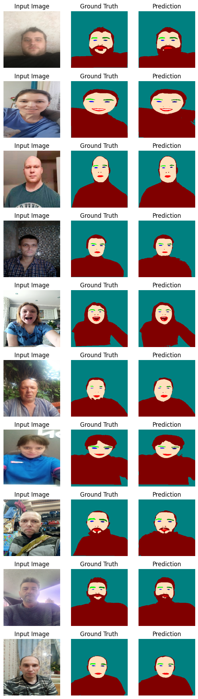
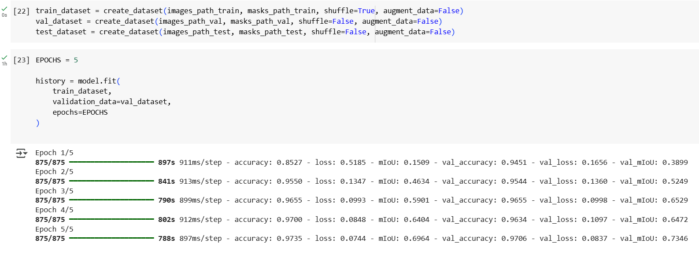
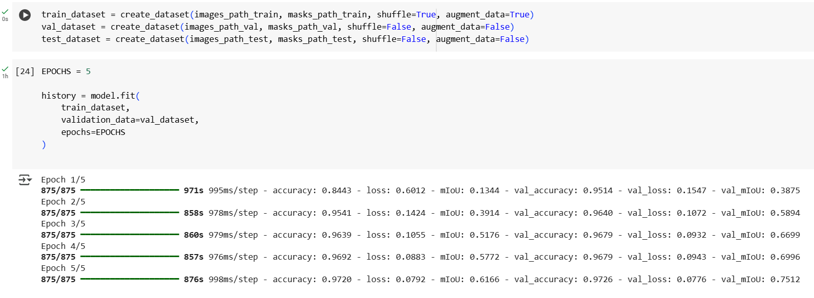

# Facial Image Segmentation with U-Net

**Bita Moharrami · University of Tehran · August 2025**

A TensorFlow/Keras implementation of U-Net for pixel-level segmentation of human portraits into nine semantic classes. The project covers data preprocessing, model training, validation and test evaluation, qualitative mask overlays, and a local webcam demonstration using OpenCV.

The original project recorded **0.8254 validation mIoU** and **0.7907 test mIoU** on EasyPortrait. These are saved experimental results, not new measurements from the cleaned notebooks.



## Model and dataset

- **Architecture:** four U-Net encoder stages with 64, 128, 256 and 512 filters; a 1024-filter bottleneck; skip connections and transposed-convolution upsampling.
- **Convolution blocks:** two convolutions, each followed by batch normalization and ReLU.
- **Input/output:** 256 × 256 RGB images and nine-class softmax predictions.
- **Training:** Adam with learning rate `1e-4`, sparse categorical cross-entropy and batch size 16.
- **Evaluation:** pixel accuracy, mean intersection-over-union (mIoU), and per-class IoU aggregated over the dataset confusion matrix. Classes with zero union contribute zero in this implementation.

The [EasyPortrait dataset](https://www.kaggle.com/datasets/kapitanov/easyportrait) supplies separate training, validation and test splits. The original notebook records 14,000 / 2,000 / 4,000 images respectively. Images are normalized to `[0, 1]`; masks are resized with nearest-neighbor interpolation to preserve class IDs. Dataset files are downloaded separately and are not bundled here.

| ID | Class | Validation IoU | Test IoU |
|---:|---|---:|---:|
| 0 | Background | 0.9734 | 0.9764 |
| 1 | Person | 0.9506 | 0.9438 |
| 2 | Skin | 0.9301 | 0.8952 |
| 3 | Left brow | 0.7173 | 0.6591 |
| 4 | Right brow | 0.7299 | 0.6752 |
| 5 | Left eye | 0.7563 | 0.7480 |
| 6 | Right eye | 0.7640 | 0.7586 |
| 7 | Lips | 0.8230 | 0.7591 |
| 8 | Teeth | 0.7842 | 0.7011 |
| | **Mean IoU** | **0.8254** | **0.7907** |

Source: saved evaluation outputs and Table 4.2 of the [original project report](docs/project-report.pdf). Machine-readable values are in [reported-metrics.json](results/reported-metrics.json).

## Repository contents

```text
notebooks/
  01_train_and_evaluate.ipynb  # Preprocessing, U-Net, training, evaluation and overlays
  02_webcam_demo.ipynb        # Local webcam inference with a saved checkpoint
assets/                      # Original recorded result figures
docs/
  project-report.pdf         # Original report, preserved unchanged
  reproducibility.md         # Cleanup changes and experimental limitations
results/
  reported-metrics.json      # Historical evaluation results
scripts/
  smoke_test.py              # Short end-to-end execution on a local data subset
requirements.txt
```

Generated checkpoints go in `models/`; new plots and metrics go in `outputs/`. Both are ignored by Git.

## Installation

Use **Python 3.11** for the pinned TensorFlow 2.15 environment. Start in the repository root.

**Windows PowerShell**

```powershell
py -3.11 -m venv .venv
.\.venv\Scripts\python.exe -m pip install --upgrade pip
.\.venv\Scripts\python.exe -m pip install -r requirements.txt
.\.venv\Scripts\python.exe -m jupyterlab
```

**Linux / macOS**

```bash
python3.11 -m venv .venv
source .venv/bin/activate
python -m pip install --upgrade pip
python -m pip install -r requirements.txt
python -m jupyterlab
```

Training this model can require substantial memory and time. Reduce `BATCH_SIZE` if needed. Native Windows runs this TensorFlow version on CPU; GPU training requires an appropriate Linux/WSL2 environment. See the [TensorFlow installation guide](https://www.tensorflow.org/install/pip) for platform-specific GPU setup; the pinned project environment is older than the latest release.

## Train and evaluate

1. Open `notebooks/01_train_and_evaluate.ipynb`.
2. Review the configuration: `EPOCHS = 18`, `BATCH_SIZE = 16`, `USE_AUGMENTATION = False`, and `SEED = 42`.
3. Run cells in order. `kagglehub` downloads EasyPortrait unless `EASYPORTRAIT_DIR` points to an existing copy. Follow Kaggle's authentication instructions if prompted.
4. The notebook saves `models/unet.keras`, new evaluation results in `outputs/evaluation.json`, and diagnostic figures in `outputs/`.

For a local dataset, set the environment variable **before launching Jupyter**:

```powershell
$env:EASYPORTRAIT_DIR = 'D:\Datasets\easyportrait'
```

The dataset root must contain `images/{train,val,test}` and `annotations/{train,val,test}`. JPEG images and PNG masks are paired by filename stem; metadata files are ignored. Existing model files are protected: choose a new checkpoint filename in the save cell when keeping multiple runs.

## Webcam demonstration

Open `notebooks/02_webcam_demo.ipynb` on a computer with a webcam and graphical desktop. It loads `models/unet.keras` by default. Adjust `MODEL_PATH` or `CAMERA_INDEX` as needed, run the cells, and press **q** in the video window to stop.

The source project also supplied an [original HDF5 checkpoint link](https://drive.google.com/file/d/1cfgWbPKmwLCA6KQtt7EI99Xw5wb2H9Gp/view?usp=drive_link). Availability and access permissions have not been verified. If accessible, download it manually to `models/model.h5` and change `MODEL_PATH` accordingly. Model weights are not included in this repository and are not downloaded automatically.

The cleaned webcam pipeline converts OpenCV's BGR frames to RGB before inference to match training preprocessing. No frame-rate or latency benchmark is claimed.

## Short pipeline check

To check the full workflow without completing a training run, provide a small local EasyPortrait subset with separate `train`, `val` and `test` folders in the same structure as the full dataset:

```powershell
.\.venv\Scripts\python.exe scripts/smoke_test.py --dataset data/smoke-easyportrait
```

The script executes the notebook code with one epoch and batch size 1, retaining the full U-Net and 256 × 256 inputs. Use only a few images per split: one epoch still processes every image in the supplied training directory. It checks weight updates, checkpoint saving/reloading, prediction agreement, evaluation, plots, augmentation and the webcam notebook using a real test image instead of a physical camera. Logs, a JSON report and generated images are saved under `outputs/smoke-<timestamp>/`. Smoke-test metrics do not estimate trained-model performance.

## Augmentation and reproducibility

The report compares five-epoch runs with and without augmentation, recording validation mIoU of **0.7512** and **0.7346** respectively. Original figures are retained below. These are descriptive single-run observations; repeated-seed uncertainty was not provided.

| Without augmentation | With augmentation |
|---|---|
|  |  |

The original notebooks used interactive training phases, differing flip probabilities, and incomplete saved training logs. The cleaned 18-epoch workflow is a starting point for new experiments, not an exact reproduction of the reported checkpoint. Augmentation remains off by default. Review the dataset's left/right label convention before using horizontal flips for directional facial classes. Details are in [reproducibility notes](docs/reproducibility.md).

## References

- Ronneberger, O., Fischer, P., and Brox, T. (2015). [U-Net: Convolutional Networks for Biomedical Image Segmentation](https://arxiv.org/abs/1505.04597).
- [EasyPortrait: Face Parsing & Portrait Segmentation](https://www.kaggle.com/datasets/kapitanov/easyportrait).

## License

No software license was supplied with the original project, so none has been assigned during cleanup. The dataset and external resources retain their own terms.
